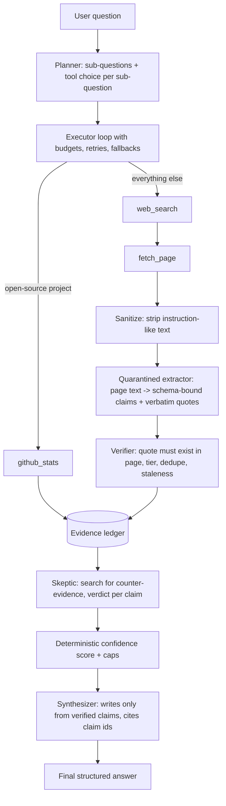

# Evidence-Ledger Research Agent

A small, production-minded research agent. You ask a research question; it plans, gathers evidence with tools,
**verifies every claim against the source text**, tries to **falsify its own findings**, and returns a structured,
source-backed answer with a confidence level computed from the evidence. If the evidence is not there, it says so
instead of guessing.

- Demo video: [`https://drive.google.com/file/d/1FUBlCvqVeXrbR2oxbFuZCFyVljLDoY46/view?usp=sharing`](https://drive.google.com/file/d/1FUBlCvqVeXrbR2oxbFuZCFyVljLDoY46/view?usp=sharing)
- Evaluation: [EVAL.md](EVAL.md) (8 test cases, agent vs. non-agentic baseline, failures found)
- Sample outputs: [samples/](samples/)

## How it works



Final answer fields: question, short answer, key findings (each ending in claim ids like `[c3, c7]`), sources,
confidence (Low/Medium/High plus score), limitations, assumptions, suggested next steps.

## Quick start (Windows PowerShell)

```powershell
git clone <this-repo-url>
cd research-agent
python -m venv .venv
.venv\Scripts\Activate.ps1
pip install -r requirements.txt
```

Create a `.env` file (all of these have a free tier, no card needed):

```text
LLM_API_KEY=your_groq_key
LLM_BASE_URL=https://api.groq.com/openai/v1
LLM_MODEL=openai/gpt-oss-120b
TAVILY_API_KEY=your_tavily_key
GITHUB_TOKEN=            # optional, raises the GitHub rate limit
```

The LLM layer uses the OpenAI SDK against any OpenAI-compatible endpoint, so the provider is swappable by changing
three variables.

```powershell
# Run the agent (show the evidence ledger and the trace)
python run.py "Compare the top 3 open-source vector databases for a startup building RAG products." --ledger --trace

# Non-agentic baseline (one LLM call, no tools, same output schema)
python run.py "<question>" --mode baseline

# Inject a failure: timeout | malformed | empty | injection | contradict
python run.py "<question>" --fault injection

# Save the full result as JSON
python run.py "<question>" --out samples/my_run.json

# Evaluation
python eval/run_eval.py --only unanswerable,tool_timeout --pause 10
```

Other flags: `--replay` (cached tool results only, no network), `--no-cache`, `--no-skeptic`, `--json`.

## Why an agentic approach?

A research question cannot be answered by a fixed pipeline, because decisions depend on what is found along the
way: which sub-questions to ask, whether a GitHub lookup or a web search is the right tool, whether the evidence is
enough, and what to do when a tool fails or a source is junk. The agent makes those decisions at runtime inside a
**bounded, single-agent loop** (planner then executor), not an open-ended multi-agent system.

An honest caveat from my own evaluation: on easy, well-known questions a one-shot LLM produces an answer that looks
just as good, in about 2-7 seconds instead of 110-245. The agent earns its cost where answers must be **checkable**
and where the evidence may not exist (see EVAL.md).

## Tools and why

| Tool | What it does | Why |
|---|---|---|
| `github_stats` | GitHub REST API: stars, forks, license, last push, open issues, archived | Primary-source numbers instead of blog opinions. Follows redirects and forks to the upstream repo; looks the repo up by name if the planner guessed the owner wrong. |
| `web_search` | Tavily search (free tier) | Finds candidate sources for qualitative questions. |
| `fetch_page` | httpx + trafilatura main-content extraction, http/https only, 8,000-character cap | Reads the actual page so claims can be checked against real text. |

Tool choice is made by the planner per sub-question. Search results are filtered before fetching: social/video/forum
domains are dropped, duplicate domains and PDFs are skipped, and higher-trust sources are preferred.

## How bad tool results are handled

- **Uniform contract:** every tool returns `ToolResult(ok, data, error, latency_ms)`; no exception escapes a tool.
- **Timeouts and retries:** 10 s timeout, 2 retries with exponential backoff.
- **Malformed output:** per-tool validators reject empty or wrong-shape results and turn them into `ok=False`.
- **Fallbacks:** failed GitHub lookup falls back to web search; unreadable pages are skipped and recorded.
- **Budgets:** hard caps on tool calls and wall-clock time for both the executor and the Skeptic; skipped
  sub-questions are listed in the limitations.
- **LLM failures:** schema-validated JSON with one self-correcting retry; network blips are retried; a rate limit opens a
  circuit breaker so a run fails fast instead of hanging. If the summarising step fails, the answer still lists the
  verified claims, capped at Low confidence.
- **Nothing found:** the answer says "insufficient verified evidence" with next steps instead of padding.

## How hallucination is reduced

1. **Quote verification (code, not LLM):** every web claim carries a verbatim quote; if the quote is not found in the
   fetched page (fuzzy match), the claim is dropped (`quote_not_found_in_source` in the trace).
2. **The synthesizer sees only verified claims** and is told to use no outside knowledge. Findings must carry valid
   claim ids; findings without them are removed. If the model cannot ground a summary, the verified claims are shown as-is.
3. **The Skeptic:** for a sample of claims (absolute wording like "only"/"lowest"/"requires" first) it searches for
   counter-evidence and sets `survived / weakened / contradicted`. Counter-evidence from low-tier sources can only
   weaken a claim, never overturn it.
4. **Deterministic confidence:** computed from the ledger, never self-reported by the model.
   Score = 0.30 coverage + 0.25 skeptic outcomes + 0.20 source quality + 0.15 source diversity + 0.10 volume.
   Hard caps: fewer than 3 usable claims or fewer than 2 distinct sources gives at most 0.35; partial coverage or too
   few challenged claims gives at most 0.69 (so never "High"). Low < 0.40, High >= 0.70.
5. **Relevance gate:** if the claims do not address the topic named in the question, the answer is "insufficient evidence".
6. **Source tiers and staleness:** official/primary = 1, reputable = 2, other = 3; claims dated over 12 months are flagged.

## Prompt-injection handling

Web pages are untrusted data. Defense in depth: (1) instruction-like sentences are stripped from page text and the
source is down-weighted to tier 3; (2) a **quarantined extractor** reads each page in isolation and can only emit
schema-bound claims, so page text never reaches the planner or the writer; (3) claims containing injection patterns
are dropped; (4) the model never chooses arbitrary actions from page content. This is a regex-based defense tested with a
synthetic attack; it is not a guarantee against a determined attacker.

## Making this production-ready

- Parallel/async fetching and extraction (execution is sequential today).
- Persistent shared cache and a job queue; per-user rate limits and spend caps; secrets management; containerization.
- Stronger verification: an entailment (NLI) model or LLM judge to check that a quote actually *supports* the claim,
  not only that it exists.
- A maintained source-reputation list instead of heuristics; a relevance model before extraction.
- Tracing through OpenTelemetry or Langfuse (the JSONL trace already has the right events).
- Evaluation as a CI gate using replayed tool responses, with a larger, human-scored test set.
- Human review queue for Low-confidence or disputed answers.

## What I would monitor in production

Per-tool success rate and latency; share of claims dropped by reason (quote not found, injection pattern); pages
flagged for injection; Skeptic verdict distribution and share of claims actually challenged; confidence
distribution and the share of runs ending in "insufficient evidence"; budget-exhaustion rate; schema-retry rate;
LLM unavailable/rate-limit rate; tokens, cost and latency per run; stale-source rate.

## Key tradeoffs

- **Single bounded agent, no framework:** easier to debug and explain than multi-agent or LangGraph, but less flexible.
- **Quarantined extraction costs an extra LLM call per page** (latency and tokens) in exchange for injection safety and verifiable quotes.
- **Quote matching is cheap and deterministic but shallow:** it proves the quote exists, not that it supports the claim.
- **The Skeptic is sampled** (a few claims, one counter-source each) to control cost, so most web claims stay "untested";
  confidence is capped accordingly.
- **Sequential execution** keeps traces simple but makes runs slow (110-245 s with a reasoning model on a free tier).
- **Free-tier LLM** (Groq, 200,000 tokens/day per model) limited how many full runs and evaluations I could do.

## Known limitations

- Evaluation is small (8 cases, one run each) and structural; answers were not human-scored.
- Source tiers are domain heuristics; vendor sites count as official and can be marketing.
- Weak or contradictory web claims can still appear (flagged as "untested") if the Skeptic did not reach them.
- English web content only; no PDF reading; dynamic pages that need JavaScript are not rendered.
- Cost figures in the reports are notional (token counts times gpt-4o-mini-class prices); actual cost was zero on free tiers.
- The non-agentic baseline's sources were often unverifiable (13 of 21 had no link), and I did not manually check whether each source supports each claim.

## Decision log: what testing changed

1. The planner picked a fork repo (29 stars) instead of the real project (46k), which created a false "contradiction": added fork/redirect resolution and a name-search fallback.
2. Regex-parsed citations silently discarded every finding and reported "insufficient evidence" despite 16 verified claims: citations became structured fields, with a graceful fallback.
3. The Skeptic let one forum post "contradict" a vendor claim: low-tier counter-evidence can now only weaken.
4. "High" confidence with only 2 of 19 web claims challenged: added confidence caps.
5. The fake-database question first returned Medium confidence from a single generic page: added a relevance gate and a single-source cap.
6. One run hung for 2,017 s on provider errors: added a circuit breaker and network retries.
7. Quota/outage runs looked like agent failures: the harness now marks runs with zero LLM tokens as INVALID and excludes them.

## Repository layout

```text
agent/        planner, executor, extractor, verifier, skeptic, confidence, synthesizer, pipeline, cache, faults, trace, llm
agent/tools/  base (uniform result + retry), search, fetch, github, registry (cache + validation + fault injection)
eval/         cases.yaml, run_eval.py, check_baseline_sources.py, results/
samples/      saved example outputs
run.py        CLI
```